# Inventory Management System

A full-stack Inventory Management application built with a **Go (Golang)** backend and an **Angular** frontend.

---

## ✨ Features

- **Product Listing & Filtering:** View all products, filter by category, and search by product name or SKU.
- **Product Management:** Add, edit, and delete products easily.
- **Stock Tracking:** Monitor current stock levels, perform stock updates, and view low-stock warning alerts.
- **Form Validations:** Built-in price and quantity input validations.
- **Database Support:** SQL database structure for storing product and inventory table data.

---

## 📸 Screenshots

### 1. Dashboard & Product Listing

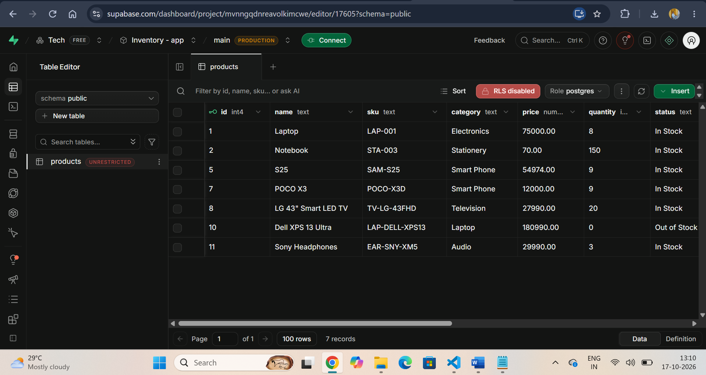
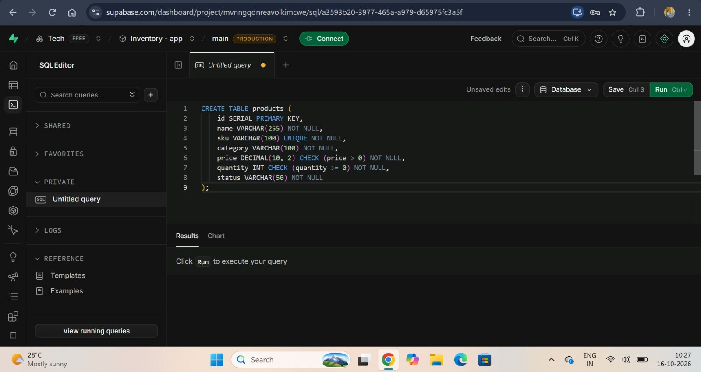

### 2. Search & Filtering
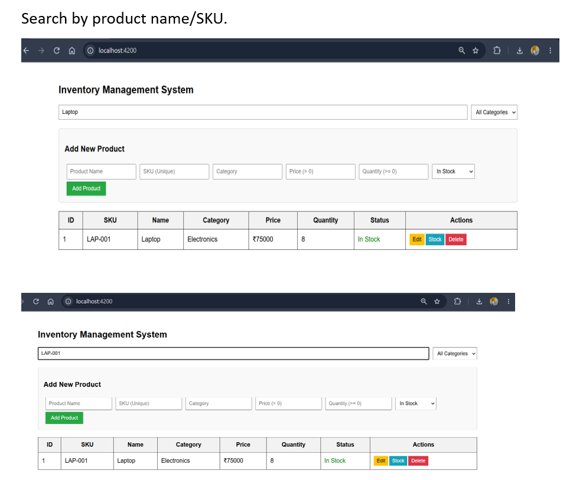
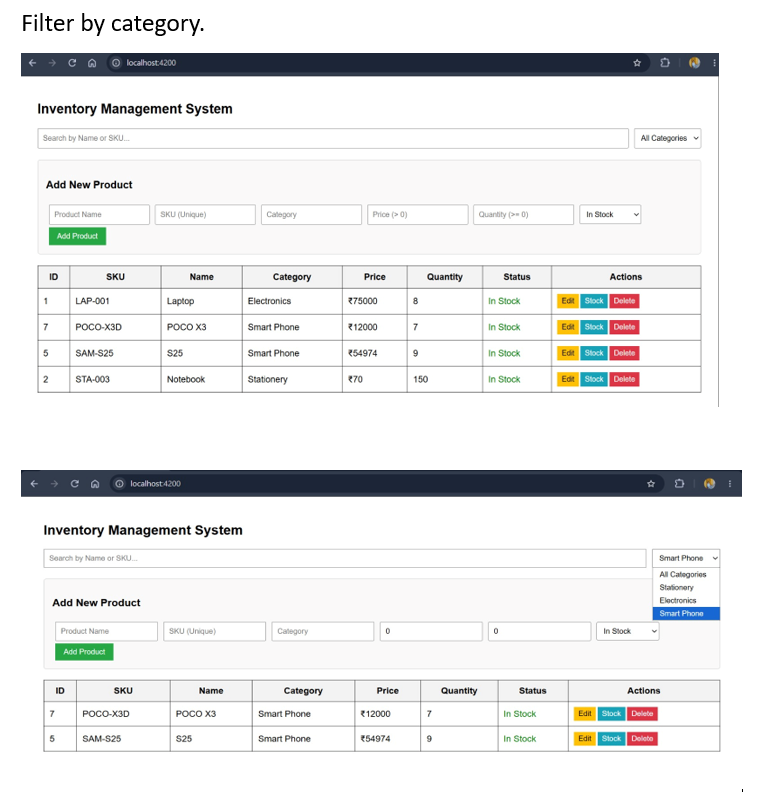

### 3. Add Product & Validations

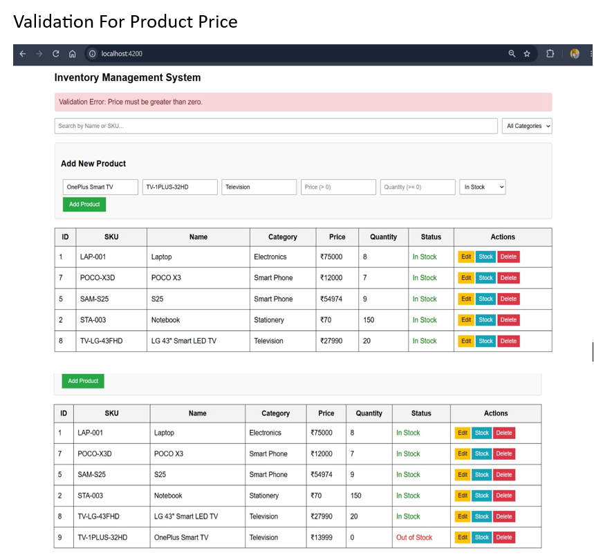
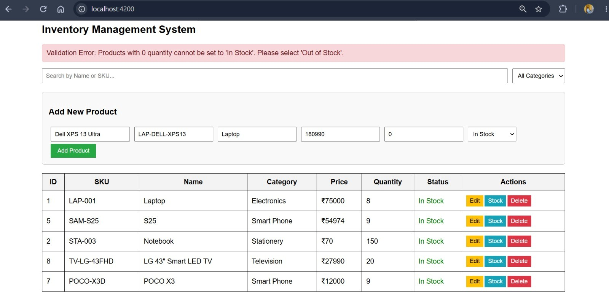

### 4. Stock & Inventory Updates
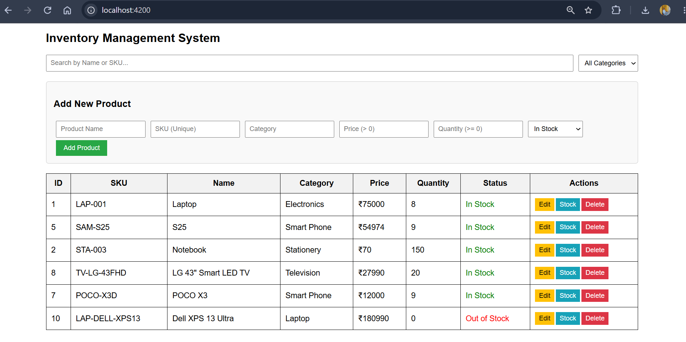
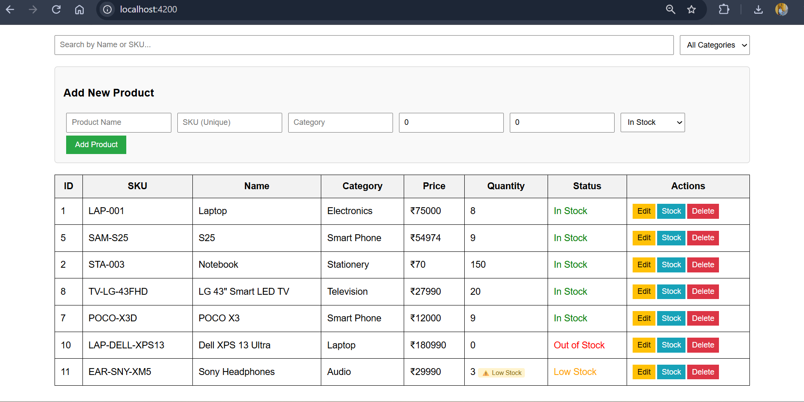
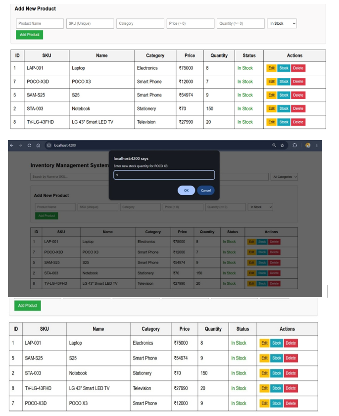

### 5. Edit Product Flow
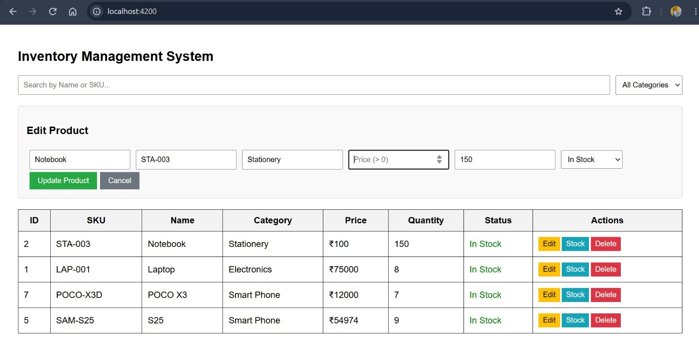

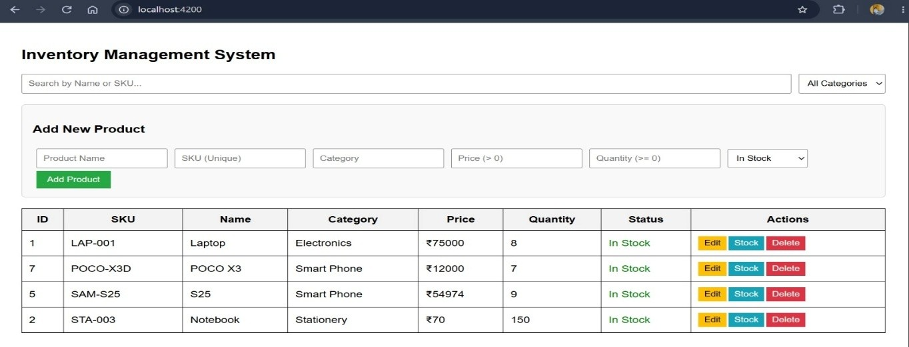

### 6. Delete Product Flow
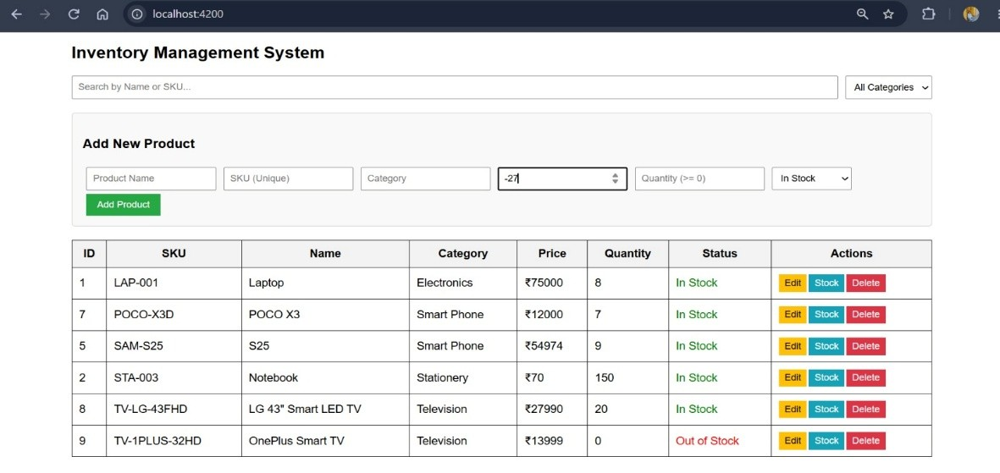
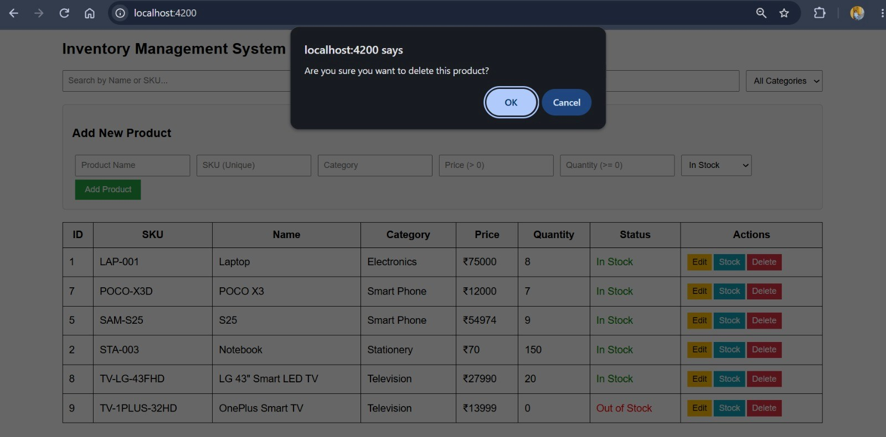
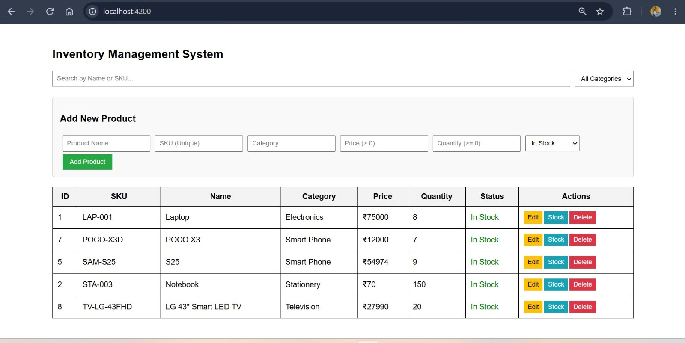

---

## 🛠 Tech Stack

- **Backend:** Go (Golang)
- **Frontend:** Angular, TypeScript
- **Database:** SQL

---

## 📁 Project Structure

```text
inventory-backend/
├── inventory-frontend/   # Angular frontend files
├── screenshots/          # Application screenshots
├── main.go               # Go backend server entry point
├── go.mod                # Go module dependencies
└── README.md             # Project documentation

```

---

## 🚀 Getting Started

### Prerequisites

* Go (v1.18 or higher)
* Node.js & npm
* Angular CLI

---

### Backend Setup

1. Navigate to the backend folder:
```bash
cd inventory-backend

```


2. Run the Go server:
```bash
go run main.go

```


---

### Frontend Setup

1. Navigate to the frontend directory:
```bash
cd inventory-frontend

```


2. Install dependencies:
```bash
npm install

```


3. Start the Angular development server:
```bash
ng serve

```


4. Open your browser and go to `http://localhost:4200/`.

```

```